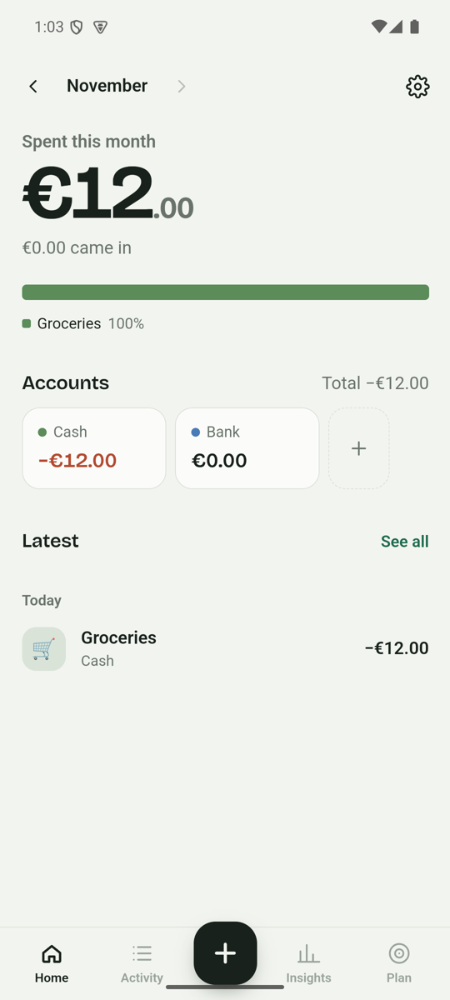
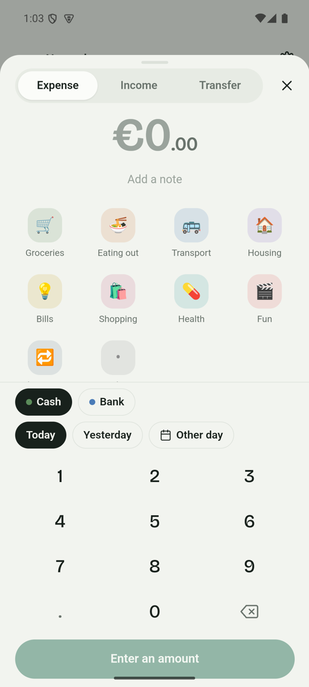

# Penny

A local-first personal finance app for Android, built with Rust and Tauri 2.
Everything is stored in SQLite on the phone. There are no accounts, no cloud and no tracking.

<p>
  
  
</p>

## Install

Download `penny.apk` from the [latest release](https://github.com/andib0/penny/releases/latest) and open it on your phone (Android 8.0 or newer).
You may need to allow your browser to install unknown apps. On Samsung phones, turn off Auto Blocker first (Settings → Security and privacy).

## Features

- **Fast entry**: a keypad sheet for logging expenses, income and transfers, with a category grid, account, date and note
- **Home**: what you've spent this month, budget left, a ribbon showing spending by category, account balances and your latest entries
- **Activity**: browse entries month by month, filter by type or account, and search notes and categories across all time
- **Insights**: money in vs. out over six months, spending per day, a month-end projection and a breakdown by category
- **Plan**: monthly budgets per category, plus recurring entries (rent, salary, subscriptions) that are logged automatically on the right day
- **Accounts and categories**: create, edit, recolour or hide them (anything that already has entries is hidden, not deleted)
- **Your data**: save a JSON backup, restore it, export a CSV for spreadsheets, or erase everything
- Light and dark themes, a currency setting, and the Android back button closes sheets

## Layout

```
core/         penny-core: pure Rust storage and finance logic (SQLite, rusqlite) plus unit tests
src-tauri/    Tauri shell that exposes penny-core as commands
src/          Svelte 5 UI
  lib/api.ts    typed command wrappers (falls back to lib/mock.ts in a plain browser)
  lib/screens/  Home, Activity, Insights, Plan
  lib/components/  sheets, keypad, lists
```

Money is stored as integer cents. Recurring dates are computed from the start date each time, so a rule on the 31st doesn't drift after February.

## Develop

```bash
npm install
npm run dev            # UI in a browser with mock data at http://localhost:1420
cd core && cargo test  # Rust logic tests
npm run tauri dev      # desktop window backed by the real Rust core
```

## Build the APK

You need the Android SDK and NDK, JDK 17 or newer, and these Rust targets: `aarch64-linux-android` and `x86_64-linux-android`.

```bash
npx tauri android build --apk --target aarch64
```

The signed APK is written to `src-tauri/gen/android/app/build/outputs/apk/universal/release/`.

On Windows without Developer Mode, Tauri can't create the symlink it needs. Use the script instead, which copies the libraries and writes `dist/penny.apk`:

```bash
bash scripts/build-apk.sh
```

Signing uses `src-tauri/gen/android/keystore.properties`, which points at `android-signing/penny-release.jks`. Both are gitignored. **Back up the keystore.** Android only installs updates that are signed with the same key.

## License

[MIT](LICENSE)
